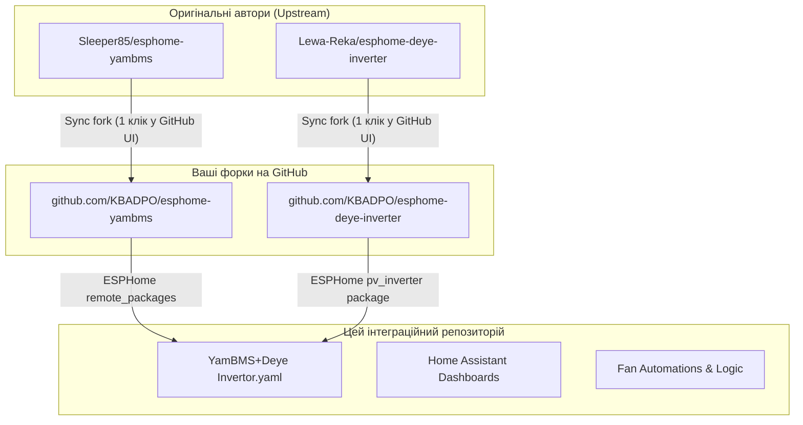

# Deye Inverter + YamBMS + Smart Cooling Fan (ESPHome)

Комплексне рішення для моніторингу та керування гібридним інвертором **Deye SG0XLP1 (1-фазний низьковольтний)**, об'єднанням кількох акумуляторних батарей через **YamBMS**, інтелектуальним охолодженням інвертора 4-піновим PWM вентилятором (20 кГц) та візуалізацією в **Home Assistant**.

---

## 📌 Архітектура та авторські проекти

Цей проект інтегрує напрацювання двох потужних рішень спільноти з індивідуальною логікою керування охолодженням:

1. **YamBMS** ([Sleeper85/esphome-yambms](https://github.com/Sleeper85/esphome-yambms)) — агрегація кількох BMS (JK-BMS BLE тощо), розрахунок струмів заряду/розряду за температурними кривими та передача даних в інвертор по шині CAN.
2. **Deye Inverter ESPHome** ([Lewa-Reka/esphome-deye-inverter](https://github.com/Lewa-Reka/esphome-deye-inverter)) — повний моніторинг і двостороннє керування регістрами інвертора Deye через RS485 (Modbus RTU).
3. **Smart PWM Fan Controller** — генерація апаратного ШІМ-сигналу 20 кГц (GPIO18) з плавним регулюванням швидкості кулера за температурою радіатора/DC/AC та аварійним захистом (fail-safe) при втраті зв'язку.
4. **Home Assistant Dashboards** — готові дашборди Lovelace для комплексного моніторингу сонячної станції, батарей та вентилятора.

---

## 🔄 Стратегія оновлення авторських проектів (Fork Workflow)

Щоб мати можливість контролювати власний код, вносити правки та водночас **в 1 клік отримувати оновлення від оригінальних авторів**, використовується підхід через **Fork**:



### Крок 1. Створення форків (одноразово)
1. Відкрийте репозиторій [Sleeper85/esphome-yambms](https://github.com/Sleeper85/esphome-yambms) і натисніть кнопку **Fork** (вгорі праворуч).
2. Відкрийте репозиторій [Lewa-Reka/esphome-deye-inverter](https://github.com/Lewa-Reka/esphome-deye-inverter) і натисніть **Fork**.
3. Тепер у вашому профілі GitHub з'являться незалежні копії обох проектів:
   - `https://github.com/KBADPO/esphome-yambms`
   - `https://github.com/KBADPO/esphome-deye-inverter`

### Крок 2. Як оновлювати ваші форки від авторів
Коли Sleeper85 або Lewa-Reka випускають оновлення чи виправлення:
1. Зайдіть на сторінку вашого форка на GitHub (наприклад, `https://github.com/KBADPO/esphome-yambms`).
2. Натисніть кнопку **Sync fork** під описом репозиторію.
3. Натисніть **Update branch**. Усі оновлення від автора миттєво підтягнуться у ваш форк!

### Крок 3. Підключення ваших форків до прошивки
У файлі `YamBMS+Deye Invertor.yaml` у секції `packages:` вкажіть посилання на ваші форки:

```yaml
packages:
  pv_inverter:
    url: https://github.com/KBADPO/esphome-deye-inverter
    ref: main
    refresh: 12h
    files: pv_inverter/deye_hybrid_1p_lv.yaml

  remote_packages:
    url: https://github.com/KBADPO/esphome-yambms
    ref: main
    refresh: 60min
    files:
      - path: 'packages/board/board_ESP32-S3_DevKitC-1_LED-48.yaml'
      # ... інші обрані пакети
```

---

## 🚀 Швидкий старт (Quick Start)

### 1. Клонування репозиторію
```bash
git clone https://github.com/KBADPO/YamBMS-Deye-Inverter-Fan.git
cd YamBMS-Deye-Inverter-Fan
```

### 2. Створення локальних робочих файлів
Файли з реальними паролями та робочими налаштуваннями додані до `.gitignore` і **не потрапляють на GitHub**.
Створіть робочі файли на основі шаблонів:
```bash
cp secrets.yaml.example secrets.yaml
cp "YamBMS+Deye Invertor.example.yaml" "YamBMS+Deye Invertor.yaml"
```
Відкрийте `secrets.yaml` (або `YamBMS+Deye Invertor.yaml`) та заповніть свої облікові дані:
- `wifi_ssid` / `wifi_password` — доступ до Wi-Fi;
- `api_key` — ключ підключення ESPHome Native API до Home Assistant;
- `ota_password` — пароль бездротової прошивки (OTA).

### 3. Компіляція та завантаження
Відкрийте **ESPHome Dashboard** у Home Assistant або скомпілюйте локально через CLI:
```bash
esphome compile "YamBMS+Deye Invertor.yaml"
esphome run "YamBMS+Deye Invertor.yaml"
```

---

## 🔌 Підключення та розпіновка (ESP32-S3 DevKitC-1)

| Функція | Пін ESP32-S3 | Призначення |
| :--- | :--- | :--- |
| **RS485 RX** | `GPIO16` | Modbus RTU RX від інвертора Deye (TTL-to-RS485) |
| **RS485 TX** | `GPIO17` | Modbus RTU TX до інвертора Deye (TTL-to-RS485) |
| **PWM Fan** | `GPIO18` | ШІМ керування швидкістю вентилятора (20 кГц) |
| **CAN Bus** | Вбудований контролер | CAN шина до порту BMS інвертора Deye |
| **RGB LED** | `GPIO48` | Індикація стану плати та мережі (DevKitC-1 LED-48) |

---

## 🎛️ Налаштування охолодження та Home Assistant

Детальні інструкції щодо додавання автоматизацій, сенсорів та Helper-змінних для керування вентилятором описані у файлі [`ha_fan_config.md`](ha_fan_config.md).

Дашборди Lovelace:
- [`Dashboard Сонячна станція.yaml`](Dashboard%20Сонячна%20станція.yaml) — розширений дашборд сонячної станції та балансування акумулятора.

---

## 📂 Структура репозиторію

```text
├── .gitignore                            # Захист secrets.yaml та локальних конфігурацій
├── secrets.yaml.example                  # Шаблон конфігурації паролів і ключів
├── YamBMS+Deye Invertor.example.yaml     # Безпечний шаблон ESPHome (Deye + YamBMS + Fan)
├── YamBMS BLE.example.yaml               # Безпечний шаблон ESPHome для YamBMS BLE
├── pv-inverter.Deye-SG0XLP1.yaml         # Базова конфігурація для інвертора Deye
├── ha_fan_config.md                      # Інструкція з налаштування логіки кулера в HA
└── Dashboard Сонячна станція.yaml        # Lovelace Dashboard станції
```

---

## 📜 Ліцензія та подяка

- Дякуємо [Sleeper85](https://github.com/Sleeper85) за проект **YamBMS**.
- Дякуємо [Lewa-Reka](https://github.com/Lewa-Reka) за розробку пакета **esphome-deye-inverter**.
- Код поширюється на умовах ліцензії GNU General Public License v3.0 (GPL-3.0).
