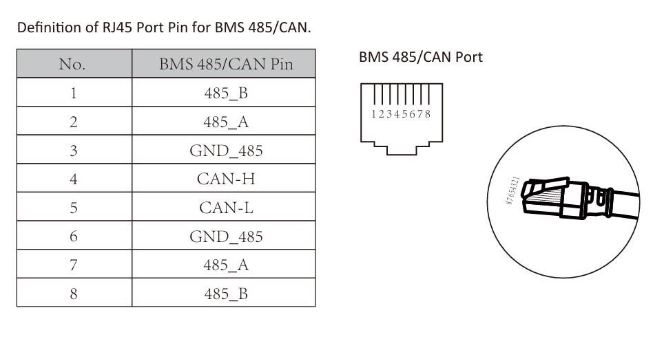
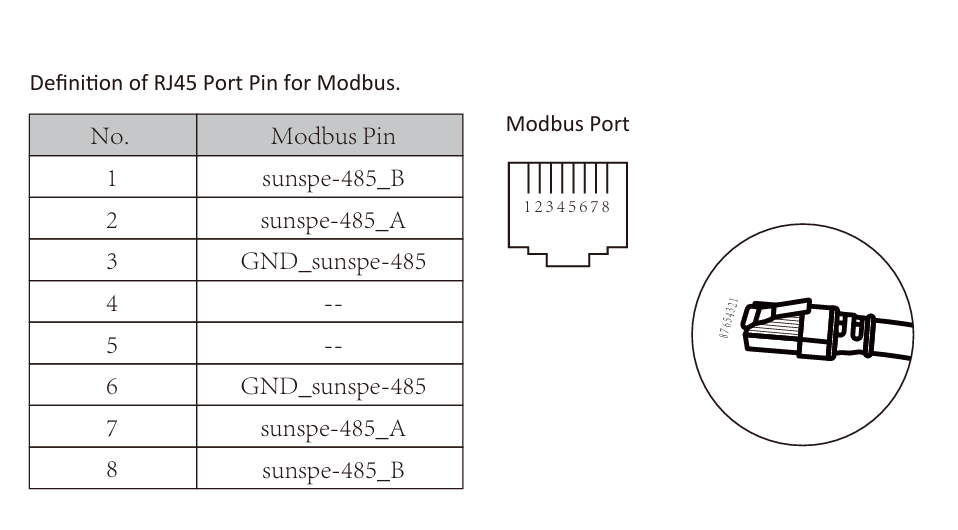
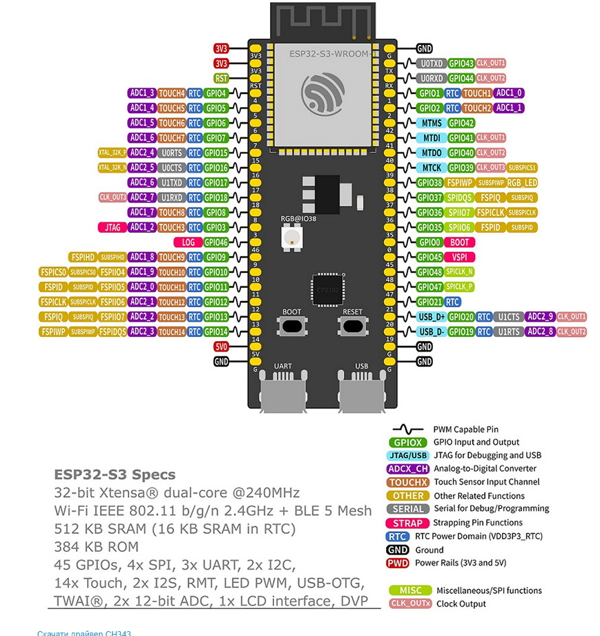

# Deye Inverter + YamBMS + Smart Cooling Fan (ESPHome & Home Assistant)

[](https://esphome.io/)
[](https://www.home-assistant.io/)
[](https://www.gnu.org/licenses/gpl-3.0)
[](https://www.espressif.com/)

**UA**: Готове рішення «під ключ» для моніторингу та керування сонячною станцією на базі гібридного інвертора **Deye SG0XLP1 (1-фазний низьковольтний 48V)**, об'єднання кількох BMS акумулятора через **YamBMS** по шині CAN, безшумного охолодження кулером (20 кГц ШІМ) та готового комплексного дашборду **Home Assistant**.

**EN**: Turnkey, production-ready solution to monitor and manage a **Deye SG0XLP1 hybrid inverter (1-phase low-voltage 48V)**, aggregate battery BMS units via **YamBMS** over CAN bus, control external high-frequency (20 kHz) PWM cooling fans, and visualize everything in **Home Assistant**.

---

## ✨ Можливості проекту / Key Features

### 1. ⚡ Моніторинг і керування Deye (RS485 Modbus RTU) / Deye Inverter Control
- **UA**: Читання всіх параметрів у реальному часі (PV генерація MPPT1/MPPT2, навантаження будинку, мережа, батарея, температури AC/DC). Двостороннє керування режимами роботи інвертора, лімітами струму та графіком Time of Use (TOU) через Home Assistant.
- **EN**: Real-time telemetry (PV MPPT1/MPPT2 power, home load, grid, battery, AC/DC heatsink temperatures). Two-way control of inverter operating modes, charge/discharge current limits, and Time of Use (TOU) schedules via Home Assistant.

### 2. 🔋 Об'єднання батарей через YamBMS (CAN Bus) / Battery Aggregation
- **UA**: Агрегація даних від кількох BMS (наприклад, JK-BMS через BLE) в один віртуальний блок. Розрахунок безпечних струмів заряду/розряду за температурою комірок (CCL/DCL) та станом заряду (Auto CVL / Float / Rebulk). Емуляція Pylontech CAN та пряма передача в BMS-порт інвертора Deye.
- **EN**: Aggregates multi-BMS data (e.g. JK-BMS via BLE) into a single virtual battery bank. Dynamically computes safe charge/discharge currents based on cell temperatures (CCL/DCL) and charging state (Auto CVL / Float / Rebulk). Emulates Pylontech CAN protocol and sends data directly into Deye BMS port.

### 3. 🌀 Розумне 20 кГц ШІМ-охолодження / Smart PWM Cooling Fan
- **UA**: Апаратна генерація ШІМ на частоті **20 кГц** (GPIO18) — відсутність шуму та писку котушок. Підтримка 2-пінових кулерів через MOSFET або 4-пінових комп'ютерних PWM кулерів. Плавне регулювання за температурами AC/DC та випереджальними тригерами потужності. Апаратний **Fail-Safe** захист (10% потужності при втраті зв'язку з HA).
- **EN**: Hardware 20 kHz PWM generation on GPIO18 — completely eliminates motor whine. Supports 2-pin fans via MOSFET module or 4-pin PC PWM fans. Dynamic speed calculation based on AC/DC heatsink temperatures and proactive power triggers. Hardware **Fail-Safe** protection (automatic 10% speed upon connection loss).

### 4. 📊 Готовий дашборд Lovelace / Ready Lovelace Dashboard
- **UA**: Повний дашборд у файлі [`Dashboard Solar Station.yaml`](Dashboard%20Solar%20Station.yaml) з анімованими потоками енергії, моніторингом комірок батареї, налаштуваннями інвертора та вкладкою керування охолодженням.
- **EN**: Comprehensive Lovelace UI in [`Dashboard Solar Station.yaml`](Dashboard%20Solar%20Station.yaml) featuring animated power flows, cell-level BMS telemetry, inverter controls, and dedicated fan settings.

---

## 🔌 Схема підключення на 1 виту пару (8 жил) / 8-Wire Twisted Pair All-in-One Wiring

**UA**: Усі комунікації між контролером ESP32-S3 та інвертором Deye (CAN-шина BMS, Modbus RS485 та живлення 12V/5V) реалізовано всього через **один стандартний 8-жильний кабель витої пари (UTP Cat5e/Cat6)**!

**EN**: All communication lines between the ESP32-S3 controller and Deye inverter (CAN bus, Modbus RS485, and 12V/5V power) are routed through a **single standard 8-wire twisted-pair Ethernet cable (UTP Cat5e/Cat6)**!

### 📋 Зведена таблиця підключення (Bilingual Pinout Table)

| Колір витої пари / UTP Wire Color | Порт Deye (Deye Port RJ45) | Модуль / Hardware Module | Контакт / Pin | Вхід/Вихід / I/O | Пін ESP32-S3 / Pin | Призначення (UA) | Purpose (EN) |
| :--- | :--- | :--- | :--- | :--- | :--- | :--- | :--- |
| **Біло-оранжевий**<br>*White-Orange* | **BMS Port**<br>Pin 4 | `SIT1051ATK/3` (CAN) | `CAN_H` | `TX / TXD` | `GPIO 4` | Передача даних CAN (`tx_pin`) | CAN Transmit (`tx_pin`) |
| **Оранжевий**<br>*Orange* | **BMS Port**<br>Pin 5 | `SIT1051ATK/3` (CAN) | `CAN_L` | `RX / RXD` | `GPIO 5` | Прийом даних CAN (`rx_pin`) | CAN Receive (`rx_pin`) |
| **Синій**<br>*Blue* | **BMS Port**<br>Pin 3 | `SIT1051ATK/3` (CAN) | — | `GND` | `GND` | Спільна земля CAN | CAN Ground |
| — | — | `SIT1051ATK/3` (CAN) | — | `VCC` | `3.3V` | Живлення трансивера CAN (3.3V) | CAN Module Power (3.3V) |
| **Зелений**<br>*Green* | **Modbus Port**<br>Pin 2 | `HW-0519` (RS485) | `A+` | `DI / TXD` | `GPIO 17` | Modbus UART TX (`uart_tx_pin`) | Modbus UART TX |
| **Біло-зелений**<br>*White-Green* | **Modbus Port**<br>Pin 1 | `HW-0519` (RS485) | `B-` | `RO / RXD` | `GPIO 16` | Modbus UART RX (`uart_rx_pin`) | Modbus UART RX |
| **Біло-синій**<br>*White-Blue* | **Modbus Port**<br>Pin 3 | `HW-0519` (RS485) | — | `GND` | `GND` | Спільна земля Modbus | Modbus Ground |
| — | — | `HW-0519` (RS485) | — | `VCC` | `3.3V` | Живлення конвертера RS485 (3.3V) | RS485 Module Power (3.3V) |
| **Біло-коричневий**<br>*White-Brown* | **+12V Power**<br>*(Deye / БЖ)* | `DC-DC Step-Down` | `IN+` (+12V) | `OUT+` (+5V) | `5V / VIN` | Вхід живлення плати ESP32 | ESP32-S3 5V Power Input |
| **Коричневий**<br>*Brown* | **GND Power**<br>*(Deye / БЖ)* | `DC-DC Step-Down` | `IN-` (GND) | `OUT-` (GND) | `GND` | Спільний мінус живлення | Common Power Ground |

---

### 🌀 Варіанти підключення кулера охолодження / Cooling Fan Connection Options

| Конфігурація / Setup | Підключення / Wiring | Пін ESP32 / Pin | Опис (UA) | Description (EN) |
| :--- | :--- | :--- | :--- | :--- |
| **Варіант 1 (Фактичний):<br>2-пін кулер + MOSFET**<br>*Option 1: 2-pin fan + MOSFET* | ШІМ сигнал ➔ Вхід `SIG` (Gate) модуля MOSFET | `GPIO 18` | Звичайний 2-дротовий кулер 12V підключається через силовий ключ MOSFET (наприклад, модуль D4184, IRF520 або LR7843). Сигнал 20 кГц ШІМ плавно регулює живлення вентилятора без писку котушок. | Standard 2-pin 12V fan driven by a power MOSFET module (e.g. D4184, IRF520, LR7843). 20 kHz PWM smoothly modulates supply voltage without audible coil noise. |
| **Варіант 2 (Альтернатива):<br>4-пін комп'ютерний PWM кулер**<br>*Option 2: 4-pin PC PWM fan* | ШІМ сигнал ➔ 4-й пін кулера (PWM) | `GPIO 18` | Комп'ютерний 4-піновий вентилятор (наприклад, Noctua, Arctic P12 PWM). Живлення +12V та GND подаються напряму, а керуючий сигнал підключається безпосередньо до GPIO18. | 4-pin PC PWM fan (e.g. Noctua, Arctic P12 PWM). Constant 12V power is supplied; speed is modulated directly via the 4th PWM wire from GPIO18. |

---

### 📌 Розпіновка портів Deye та плати ESP32-S3 / Deye & ESP32 Pinout References

<p align="center">
  
  &nbsp;&nbsp;&nbsp;&nbsp;
  
</p>

<p align="center">
  
</p>

---

## 🚀 Покрокове налаштування / How to Replicate Step-by-Step

> [!NOTE]
> **UA**: Вам **не потрібно** вручну завантажувати або клонувати сторонні пакети `esphome-deye-inverter` та `esphome-yambms`! Усі посилання на перевірені робочі форки автора ([`KBADPO/esphome-deye-inverter`](https://github.com/KBADPO/esphome-deye-inverter) та [`KBADPO/esphome-yambms`](https://github.com/KBADPO/esphome-yambms)) уже прописані в секції `packages:` у файлі [`YamBMS+Deye Inverter.example.yaml`](YamBMS+Deye%20Inverter.example.yaml). ESPHome автоматично завантажить потрібні компоненти по мережі під час компіляції.  
> **EN**: You **do NOT need** to manually clone or download external package repositories! Direct links to the author's tested forks are already integrated inside the `packages:` section of [`YamBMS+Deye Inverter.example.yaml`](YamBMS+Deye%20Inverter.example.yaml). ESPHome downloads everything automatically during compilation.

### Спосіб А: Через веб-інтерфейс Home Assistant (Найпростіший) / Option A: Via Home Assistant ESPHome Dashboard (Easiest)
1. Відкрийте **ESPHome Dashboard** у Home Assistant ➔ Натисніть **+ New Device**.
2. Відкрийте створений файл та скопіюйте вміст [`YamBMS+Deye Inverter.example.yaml`](YamBMS+Deye%20Inverter.example.yaml).
3. У файлі `secrets.yaml` (в ESPHome Dashboard) пропишіть ваші `wifi_ssid`, `wifi_password`, `api_key`.
4. Вкажіть параметри вашої батареї (кількість комірок, струми) та MAC-адресу BMS (`bms_ble_mac_address`).
5. Натисніть **Install** — прошивка скомпілюється і завантажиться на ESP32 по Wi-Fi (OTA) або через USB.

### Спосіб Б: Через консоль / Option B: Via Command Line (CLI)
```bash
# 1. Клонувати репозиторій / Clone repo
git clone https://github.com/KBADPO/YamBMS-Deye-Inverter-Fan.git
cd YamBMS-Deye-Inverter-Fan

# 2. Налаштувати secrets.yaml / Configure secrets
cp secrets.yaml.example secrets.yaml

# 3. Створити робочий конфіг / Create config
cp "YamBMS+Deye Inverter.example.yaml" "YamBMS+Deye Inverter.yaml"

# 4. Компіляція та прошивка / Compile & Flash
esphome run "YamBMS+Deye Inverter.yaml"
```

### Інтеграція в Home Assistant / Home Assistant Setup
1. **ESPHome**: Пристрій автоматично з'явиться в Home Assistant — натисніть «Налаштувати» та введіть API-ключ.
2. **Охолодження / Smart Fan**: Створіть необхідні помічники (helpers) та автоматизацію за інструкцією у файлі **[`ha_fan_config.md`](ha_fan_config.md)**.
3. **Дашборд Lovelace**: Імпортуйте готовий дашборд сонячної станції з файлу **[`Dashboard Solar Station.yaml`](Dashboard%20Solar%20Station.yaml)**.

> 📖 **UA: Потрібен інший інвертор (Victron, Growatt тощо), інша модель BMS або дротове підключення?**  
> Читайте детальне керівництво з редагування конфігурацій та правил **гальванічної ізоляції** у файлі **[`inverter_bms_customization.md`](inverter_bms_customization.md)**.  
> *📖 **EN: Need to adapt for a different inverter, BMS model, or wired connection?**  
> Check our step-by-step customization and **galvanic isolation** guide in **[`inverter_bms_customization.md`](inverter_bms_customization.md)**.*

---

## 🎛️ Зведення помічників кулера / Fan Control Helpers Summary

| Помічник / Helper | Замовчування / Default | Опис (UA) | Description (EN) |
| :--- | :--- | :--- | :--- |
| `sensor.deye_inverter_ac_temperature` | — | Температура радіатора AC | AC heatsink temperature |
| `sensor.deye_inverter_dc_temperature` | — | Температура радіатора DC | DC heatsink temperature |
| `number.inverter_cooling_fan_fan_speed_target` | — | Цільова швидкість обдуву (0–100%) | Target fan speed (0–100%) |
| `input_number.fan_start_speed` | `20 %` | Стартова швидкість при пуску | Initial fan start speed |
| `input_number.fan_hysteresis` | `2 °C` | Гістерезис вимкнення за температурою | Temperature turn-off hysteresis |
| `input_number.fan_ac_min_temp` | `45 °C` | Температура старту кулера по AC | AC start threshold temperature |
| `input_number.fan_ac_max_temp` | `65 °C` | Температура 100% обертів по AC | AC max speed temperature |
| `input_number.fan_dc_min_temp` | `45 °C` | Температура старту кулера по DC | DC start threshold temperature |
| `input_number.fan_dc_max_temp` | `65 °C` | Температура 100% обертів по DC | DC max speed temperature |
| `input_select.fan_control_law` | `Linear` | Закон зміни обертів (`Linear`, `Logarithmic`, `Reverse Logarithmic`) | Fan response curve |
| `input_boolean.enable_pv_power_trigger` | `off` | Дозвіл пуску за потужністю сонця (PV) | Enable trigger by solar PV generation |
| `input_number.pv_power_threshold` | `3000 W` | Поріг потужності сонця | PV power trigger threshold |
| `input_boolean.enable_out_power_trigger` | `off` | Дозвіл пуску за навантаженням інвертора | Enable trigger by output load |
| `input_number.out_power_threshold` | `2000 W` | Поріг вихідної потужності | Load power trigger threshold |
| `input_boolean.enable_grid_power_trigger` | `off` | Дозвіл пуску за потужністю мережі | Enable trigger by grid power |
| `input_number.grid_power_threshold` | `2000 W` | Поріг потужності мережі | Grid power trigger threshold |

> Повний код налаштувань дивіться у файлі **[`ha_fan_config.md`](ha_fan_config.md)**.

---

## 📂 Структура репозиторію / Repository Structure

```text
├── images/                               # Схеми розпіновки та підключення / Pinout diagrams
│   ├── deye_bms_can_rj45.png             # Розпіновка BMS CAN порту Deye / Deye BMS CAN port
│   ├── deye_modbus_rj45.png              # Розпіновка Modbus порту Deye / Deye Modbus port
│   └── esp32_s3_pinout.png               # Розпіновка ESP32-S3 WROOM-1 / ESP32-S3 pinout
├── .gitignore                            # Захист secrets.yaml та робочих файлів
├── secrets.yaml.example                  # Шаблон паролів, ключів Wi-Fi та API
├── YamBMS+Deye Inverter.example.yaml     # Шаблон прошивки ESPHome (Deye + YamBMS + Fan)
├── YamBMS BLE.example.yaml               # Шаблон прошивки ESPHome для автономного режиму YamBMS BLE
├── pv-inverter.Deye-SG0XLP1.yaml         # Базовий пакет сенсорів і регістрів Deye
├── inverter_bms_customization.md         # Гайд з адаптації під інші інвертори/BMS та гальванічної ізоляції
├── ha_fan_config.md                      # Інструкція з налаштування кулера в Home Assistant
├── Dashboard Solar Station.yaml          # Готовий дашборд станції (BMS, Deye, Fan)
└── Dashboard Overview.yaml               # Альтернативний дашборд
```

---

## 📜 Ліцензія та подяка / License & Acknowledgments

- Дякуємо [Sleeper85](https://github.com/Sleeper85) за проект [YamBMS](https://github.com/Sleeper85/esphome-yambms).
- Дякуємо [Lewa-Reka](https://github.com/Lewa-Reka) за розробку [esphome-deye-inverter](https://github.com/Lewa-Reka/esphome-deye-inverter).
- Код поширюється на умовах ліцензії GNU General Public License v3.0 (GPL-3.0).


